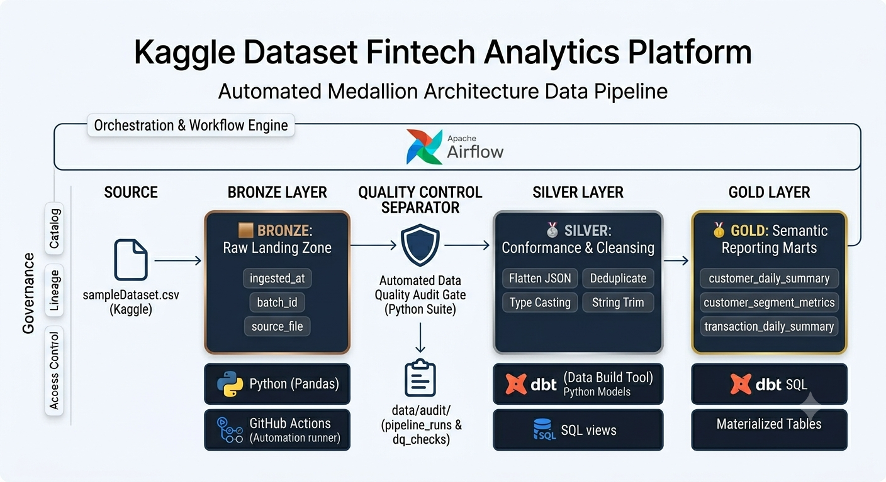

# Capital One Analytics: End-to-End Financial & Credit Risk Pipeline

An enterprise-grade data engineering project orchestrating financial wealth management profiles, lending histories, and transactional ledgers. This pipeline automates data ingestion, executes real-time quality audits, and models analytics using a medallion architecture powered by **Python**, **Airflow**, and **dbt**.

---

## Architectural Framework

### Medallion Layer Definitions
*   **🟫 Bronze Layer**: Raw landing zone. Stores the source datasets exactly as received with immutable ingestion audit parameters.
*   **🥈 Silver Layer**: Conformance and data quality layer. Standardizes column names, casts messy string-dictionaries into clean tabular formats, validates value ranges, and handles duplicates.
*   **🥇 Gold Layer**: Semantic reporting layer. Delivers performance-optimized, analytical tables designed for direct querying and dashboard consumption.

### Pipeline Flow Diagram



---

## Schema Freeze Contract (Ver. 1.0.0)

Before processing, input headers were mapped and locked into the following programmatic matrices to prevent runtime type drift:

*   **👤 Customer Fields:** `Customer Profile.customer_id`, `Customer Profile.age`, `Customer Profile.occupation`, `Customer Profile.education_level`, `Customer Profile.marital_status`, `Customer Profile.dependents`, `Customer Profile.region`, `Customer Profile.employment_history`, `Customer Profile.address`
*   **💸 Transaction Fields:** `Transaction Description`, `Account Activity.account_id`, `Account Activity.balance`, `Account Activity.deposits`, `Account Activity.withdrawals`, `Account Activity.transfers`, `Account Activity.international_transfers`, `Account Activity.investments`, `Account Activity.account_type`, `Loan Application Summary.loan_amount`, `Loan Application Summary.loan_purpose`, `Loan Application Summary.loan_term`, `Loan Application Summary.interest_rate`, `Time Series Data.transactions`, `Time Series Data.repayments`
*   **⚠️ Risk / Behavior Fields:** `Customer Profile.risk_tolerance`, `Customer Profile.investment_goals`, `Customer Profile.financial_history`, `Customer Profile.sector`, `Customer Profile.income_level`, `Account Activity.customer_id`, `Account Activity.transaction_threshold`, `Loan Application Summary.employment_status`, `Loan Application Summary.loan_status`
*   **📅 Date/Time Fields:** `Time Series Data.dates`

---

## Production Data Dictionary

Analysts can query these final production-ready assets directly in the workspace:


| Target Layer | Production Table Name | Primary Key | Description |
| :--- | :--- | :--- | :--- |
| **🥇 Gold Mart** | `gold.customer_daily_summary` | `customer_id`, `activity_date` | Aggregated daily balances, deposits, and market investment allocations per user. |
| **🥇 Gold Mart** | `gold.customer_segment_metrics` | *Cohort Composite* | Strategic demographic clustering grouping risk tolerances against outstanding loan volume. |
| **🥇 Gold Mart** | `gold.transaction_daily_summary` | `activity_date`, `account_type` | High-frequency volume velocity monitors tracking fraud threshold breaches. |
| **📋 Audit Log** | `audit.pipeline_runs` | `run_id` | Core DAG runtime execution tracking framework engine logs. |
| **📋 Audit Log** | `audit.data_quality_checks` | `check_id` | Column-level assertion test histories (Unique, Not Null, In-Bounds). |

---

## Sample Executive Query

This query runs on the Gold layer to flag high-risk customers who have approved loans but are exceeding their standard account velocity thresholds:

```sql
SELECT 
    m.customer_id,
    m.region_code,
    m.total_cash_balance,
    t.high_velocity_threshold_breaches
FROM gold.customer_daily_summary m
INNER JOIN gold.transaction_daily_summary t 
    ON m.activity_date = t.activity_date
INNER JOIN dbt.stg_loan_application_summary l 
    ON m.customer_id = l.customer_id
WHERE l.loan_approval_status = 'APPROVED'
  AND t.high_velocity_threshold_breaches > 0
ORDER BY m.total_cash_balance DESC;
```

---

## Production Log Output Sample

When the automated execution workflow finishes processing on GitHub Actions, the following diagnostic report is compiled into your run tracking history:

```text
--- PIPELINE DIAGNOSTICS ---
Current working directory: /home/runner/work/capital-one-analytics/capital-one-analytics
Looking for source file at: .../data/bronze/sampleDataset.csv
Contents of 'data/bronze/': ['sampleDataset.csv']
--------------------------------

Starting Ingestion for: data/bronze/sampleDataset.csv
Ingestion successful! Stored data at: data/bronze/bronze_raw_landing.csv

Running Bronze Integrity Gates for: data/bronze/bronze_raw_landing.csv
[PASS] required_metadata_columns_exist (Failure Count: 0)

Bronze Layer build and quality validations complete.
Process completed with exit code 0. ✅
```
